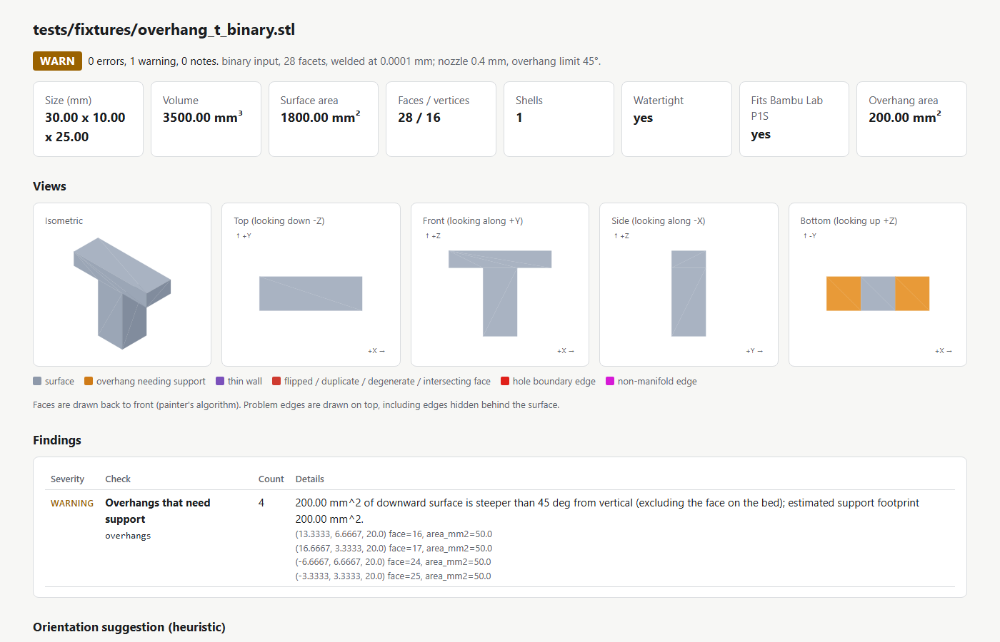
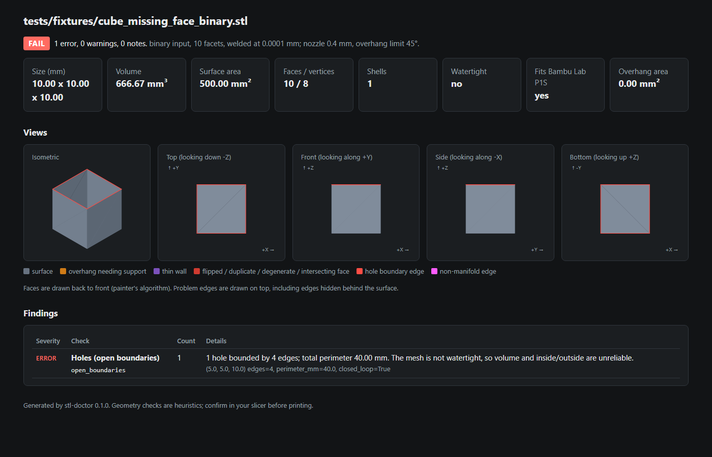

# stl-doctor

[](https://github.com/projectbin07-stack/stl-doctor/actions/workflows/ci.yml)
[](LICENSE)

Inspect STL and 3MF meshes for 3D-printing problems before slicing, and explain what is wrong and
where.

`stl-doctor` is a dependency-free Python command-line tool and library. It reads a mesh, runs
topology and printability checks, prints a pass/warn/fail verdict with coordinates for every
problem, and can write JSON for CI or a self-contained HTML report with SVG views. Repairs are
opt-in and always go to a new file.



## Why it exists

When you print many small parts, a broken mesh usually shows up late: as a slicer warning that is
easy to click past, a missing wall in the preview, or a failed print. Slicers repair silently and
interactively; that is fine for one file, but not for checking every STL in a product repository on
each commit. `stl-doctor` is meant for that gap: a scriptable checker with exact counts, locations
and an exit code, that runs anywhere Python runs without installing a geometry stack.

### How it differs from existing tools

These tools are mature and do much more geometry than this project. The comparison is about the
kind of tool, not quality:

| Tool | What it is | Where `stl-doctor` differs |
| --- | --- | --- |
| [ADMesh](https://github.com/admesh/admesh) | C program and library that checks and repairs STL files (merging nearby vertices, removing unconnected facets, filling holes, fixing normal directions) and prints statistics. | No compiler or native library needed; adds printability checks (overhang, thin walls, bed fit, orientation), 3MF input, JSON and an HTML report with locations. |
| Autodesk Meshmixer | Interactive desktop application with analysis tools (inspector, overhangs, thickness, orientation). | Not interactive: runs headless in CI, produces the same report every time, and is open source. |
| PrusaSlicer / Bambu Studio repair | Repairs meshes on import inside the slicer GUI. | Runs before the slicer and tells you *what* was wrong and *where*, so the source model (CAD export) can be fixed instead of patched at slice time. |
| [trimesh](https://github.com/mikedh/trimesh) | General-purpose Python mesh library built on numpy, with many optional dependencies. | A focused checker with a CLI, a verdict and exit codes rather than a library API; pure standard library (numpy optional). |

No code was taken from these projects; the algorithms here are standard textbook techniques written
for this repository.

## Features

Reading
- ASCII and binary STL, format detected from the content: a binary file whose header starts with
  `solid` is still read as binary when its size matches the facet count.
- Clear errors for truncated binaries, unclosed ASCII facets, bad numbers (with line numbers) and
  empty files. Facets with NaN/infinite coordinates are dropped and reported as an error finding.
- 3MF: every build item of the plate with its transform, including components stored in other
  model parts (`p:path`, as Bambu Studio and PrusaSlicer write them). The whole plate is checked
  as one mesh, and the result is broken down per build item (`objects` in `--json`, and a line per
  failing item in the text output).

Mesh model
- Vertex welding with a tolerance (spatial hash, default 0.0001 mm), indexed faces, edge map.

Checks (each with severity, count and locations)

| Code | Severity | What it means |
| --- | --- | --- |
| `non_finite_vertices` | error | NaN/inf coordinates in the file |
| `non_manifold_edges` | error | an edge shared by more than two faces |
| `open_boundaries` | error | holes: boundary loops with edge count and perimeter |
| `inconsistent_winding` | error | faces whose winding disagrees with their shell (BFS propagation per shell) |
| `exceeds_bed` | error / warning | larger than the build volume (warning if it fits after a 90 degree turn) |
| `inside_out` | warning | closed shell wound the wrong way for where it sits: an outer body with negative volume, or a cavity inside a body with outward normals |
| `normal_mismatch` | warning | stored facet normal more than 45 degrees from the winding normal |
| `degenerate_faces` | warning | zero-area faces or faces collapsed by welding |
| `duplicate_faces` | warning | faces repeating the vertices of an earlier face |
| `tiny_shells` | warning | extra shells smaller than 1 mm in every direction |
| `self_intersections` | warning | triangles crossing other triangles (uniform-grid broad phase) |
| `overhangs` | warning | downward faces steeper than the overhang limit, excluding faces on the bed |
| `thin_walls` | warning | wall faces whose opposite wall is closer than N x nozzle |
| `multiple_shells` | info | more than one shell in the file (bodies and voids counted separately) |
| `internal_voids` | info | a correctly wound cavity (inward normals) inside a body; never "repaired" |
| `embedded_shells` | info | an outward shell lying entirely inside another body (counted twice in the volume) |
| `missing_normals` | info | zero stored normals (allowed by the format) |

Also reported: bounding box, signed volume and surface area (total and per shell, with each shell's
role: body, void, embedded, inside_out or open), watertightness, whether the volume is a sum over
shells that overlap (`volume_is_sum_of_overlapping_shells`; the printed volume is then smaller),
fit on Bambu Lab P1S/P1P/X1C/A1 (256 mm cube), A1 mini (180 mm cube) or a custom bed.

Printability
- Overhang map with area and projected (support footprint) area.
- Thin-wall candidates by casting a ray inward from each near-vertical face against the mesh.
- Best-orientation suggestion that minimises overhang area over about 200 sampled directions.
  This is a heuristic: it ignores bridging, strength along layers, surface finish and the
  support's own contact area.

Repairs (`stl-doctor repair IN OUT`, never in place)
- Weld vertices, remove degenerate and duplicate faces, unify winding per shell, invert inside-out
  shells (a correctly wound cavity is kept as it is), fill simple planar holes by ear clipping, recompute all normals. The change log lists
  exactly what changed and re-checks the result.

Outputs
- Terminal summary with a verdict; `--json`; exit codes 0 (pass), 1 (warnings, only with
  `--strict`), 2 (errors or unreadable input).
- Self-contained HTML report: isometric, top, front, side and bottom views as inline SVG drawn with
  the painter's algorithm, problem faces and edges highlighted, light/dark via
  `prefers-color-scheme`, no JavaScript and no external resources.

## Install

Requires Python 3.10 or newer. Not published on PyPI; install from the repository:

```console
pip install "git+https://github.com/projectbin07-stack/stl-doctor.git"
# optional: numpy speeds up the orientation search
pip install "stl-doctor[fast] @ git+https://github.com/projectbin07-stack/stl-doctor.git"
```

## Quick start

The outputs below are from the fixtures in `tests/fixtures`, run with version 0.2.0.

```console
$ stl-doctor check overhang_t_binary.stl
stl-doctor 0.2.0  overhang_t_binary.stl
  format     binary, 28 facets in file
  mesh       28 faces, 16 vertices (welded at 0.0001 mm), 1 shell(s)
  size       30.00 x 10.00 x 25.00 mm, fits Bambu Lab P1S (256 x 256 x 256 mm)
  volume     3500.00 mm^3
  area       1800.00 mm^2

  WARN  Overhangs that need support [overhangs]: 4
        200.00 mm^2 of downward surface is steeper than 45 deg from vertical (excluding the face on the bed); estimated support footprint 200.00 mm^2.
        at (13.3333, 6.6667, 20.0) face=16, area_mm2=50.0
        at (16.6667, 3.3333, 20.0) face=17, area_mm2=50.0
        at (-6.6667, 6.6667, 20.0) face=24, area_mm2=50.0
        ... 1 more (see --json or --report)

  orientation (heuristic): rotate 90.0 deg about X, then 0.0 deg about Y -> overhang 200.00 -> 0.00 mm^2

verdict: WARN (0 errors, 1 warning, 0 notes)
```

A mesh with a flipped triangle whose stored normal was left unchanged:

```console
$ stl-doctor check cube_flipped_face_ascii.stl
...
  FAIL  Inconsistent winding / flipped faces [inconsistent_winding]: 1
        3 edges joined faces with opposite winding; 1 face disagrees with the rest of the shell (their normals point the wrong way).
        at (6.6667, 3.3333, 10.0) face=2
  WARN  Stored normals disagree with winding [normal_mismatch]: 1
        1 face stores a normal more than 45 deg away from the one implied by the vertex order. Slicers use the vertex order; `stl-doctor repair` rewrites the normals.
        at (6.6667, 3.3333, 10.0) face=2

verdict: FAIL (1 error, 1 warning, 0 notes)
$ echo $?
2
```

Repair a cube with a missing face into a new file:

```console
$ stl-doctor repair cube_missing_face_binary.stl fixed.stl
repaired cube_missing_face_binary.stl -> fixed.stl
  faces: 10 in, 12 out
  welded 0 near-duplicate vertices (beyond exact matches)
  removed 0 degenerate faces
  removed 0 duplicate faces
  flipped 0 faces to make winding consistent
  inverted 0 inside-out shells
  filled 1 hole with 2 triangles
  normals recomputed from winding for every face
  watertight: False -> True, volume 666.67 -> 1000.00 mm^3
```

A 20 mm cube with a 10 mm internal void (inner shell wound inward, as a cavity should be) is
recognised as a void, and `repair` leaves it alone:

```console
$ stl-doctor check hollow.stl
...
  volume     7000.00 mm^3
...
  INFO  Internal voids [internal_voids]: 1
        1 closed shell is a cavity inside a body, wound with inward normals as a cavity should be. The slicer leaves it empty and the volume already excludes it; `stl-doctor repair` keeps it.
        at (10.0, 10.0, 10.0) volume_mm3=-1000.0
$ stl-doctor repair hollow.stl fixed.stl
...
  inverted 0 inside-out shells
...
  watertight: True -> True, volume 7000.00 -> 7000.00 mm^3
```

Suggest an orientation and write the rotated mesh:

```console
$ stl-doctor orient overhang_t_binary.stl -o t_oriented.stl
overhang_t_binary.stl: 206 orientations sampled (heuristic)
  current: overhang 200.00 mm^2, height 25.00 mm
  #1: rotate   90.00 deg about X, then    0.00 deg about Y -> overhang 0.00 mm^2, bed contact 350.00 mm^2, height 10.00 mm
  #2: rotate  -90.00 deg about X, then    0.00 deg about Y -> overhang 0.00 mm^2, bed contact 350.00 mm^2, height 10.00 mm
  #3: rotate  180.00 deg about X, then    0.00 deg about Y -> overhang 0.00 mm^2, bed contact 300.00 mm^2, height 25.00 mm
  wrote best orientation to t_oriented.stl
```

HTML report and JSON:

```console
stl-doctor check part.stl --printer a1-mini --nozzle 0.4 --overhang 50 --report part.html
stl-doctor check part.stl --json > part.json
```



### Use in CI

```yaml
- run: pip install "git+https://github.com/projectbin07-stack/stl-doctor.git"
- run: |
    for f in models/*.stl; do stl-doctor check "$f" --printer a1-mini --strict || exit 1; done
```

`--strict` makes warnings (overhangs, thin walls, ...) fail the job; without it only errors do.

### Command reference

```text
usage: stl-doctor [-h] [--version] {check,repair,orient} ...

  check               analyse a mesh and print a verdict
  repair              write a repaired copy of a mesh
  orient              suggest a print orientation with less overhang (heuristic)

usage: stl-doctor check [-h] [--weld-tol MM] [--printer {a1,a1-mini,p1p,p1s,x1c}] [--bed WxDxH]
                        [--nozzle MM] [--thin-factor N] [--overhang DEG] [--tiny-shell MM]
                        [--report HTML] [--json] [--strict] [--no-intersections] [--no-thin-walls]
                        file
  --weld-tol MM         merge vertices closer than this (default 0.0001 mm; 0 = exact matches only)
  --printer             build volume to check against (default p1s)
  --bed WxDxH           custom build volume in mm
  --nozzle MM           default 0.4
  --thin-factor N       report walls thinner than N x nozzle (default 2)
  --overhang DEG        overhang limit measured from vertical (default 45)
  --tiny-shell MM       flag extra shells smaller than this in every direction (default 1)
  --report HTML         write a self-contained HTML report
  --json                print JSON instead of text
  --strict              exit 1 when there are warnings
  --no-intersections    skip the self-intersection test
  --no-thin-walls       skip the thin-wall test

usage: stl-doctor repair [-h] [--weld-tol MM] [--ascii] [--no-fill] [--json] [--force] input output
  --ascii        write ASCII STL (default binary)
  --no-fill      do not fill holes
  --json         print the change log as JSON
  --force        overwrite OUTPUT if it exists (never the input file)

usage: stl-doctor orient [-h] [--weld-tol MM] [--overhang DEG] [--samples N] [--top N] [-o STL]
                         [--json] file
  --samples N       directions to try (default 200, plus the 6 axis directions)
  --top N           candidates to list (default 3)
  -o, --output STL  write the mesh rotated to the best orientation
```

## Architecture

```text
src/stl_doctor/
  stlio.py         STL reader/writer, content-based format detection
  threemf.py       3MF reader (zipfile + ElementTree), components and transforms
  mesh.py          vertex welding (spatial hash), indexed Mesh, edge map, load_mesh()
  topology.py      shells, BFS winding propagation, boundary loops, signed volume
  grid.py          uniform grid over triangle bounding boxes; ray/triangle test
  intersect.py     triangle/triangle test + grid broad phase
  printability.py  overhangs, thin walls, orientation search (numpy optional)
  analysis.py      runs all checks, builds Findings and the Report (verdict, JSON)
  repair.py        repairs and ear-clipping hole filler
  html_report.py   HTML/SVG report
  cli.py           argparse front end
```

Notes on the algorithms and their limits:

- **Welding** puts each vertex in a hash cell of size `tolerance` and compares it with the 27
  neighbouring cells, so merging is exact to the tolerance and roughly linear in time.
- **Winding** is propagated breadth-first across edges shared by exactly two faces. Within each
  shell the majority winding is taken as correct, so a single flipped face is reported as that face.
  Whether the majority points the right way is decided separately, from the shell's signed volume
  and what contains it.
- **Nesting**: a closed shell is inside another when its bounding box lies within the other's and
  the generalised winding number (sum of signed solid angles / 4 pi) of a point on it, with respect
  to the other shell, has magnitude above one half. Outermost shells should enclose positive
  volume, a cavity inside a body negative volume, an island inside a cavity positive again. An
  outward shell directly inside a body is treated as a buried body (`embedded_shells`), not as a
  wrongly wound cavity, because the two cannot be told apart from geometry alone.
- **Self-intersection**: each triangle is registered in the grid cells its bounding box overlaps;
  pairs that share a cell and whose boxes overlap get an exact plane-separation / interval-overlap
  test. Expected cost is close to linear for evenly sized triangles, worst case O(F^2) pair tests
  when large triangles span many cells. Pairs sharing a vertex are skipped, and contacts that only
  touch (zero-length overlap) are not reported.
- **Thin walls**: a ray from each near-vertical face centroid (normal within 45 degrees of
  horizontal) along the inward normal is tested against grid candidates up to the threshold
  distance. This measures thickness perpendicular to the wall at one point per face; it can miss
  thin spots between sample points and does not measure horizontal thin layers.
- **Printability on broken meshes** uses winding-corrected normals, so a flipped face is not also
  reported as an overhang.
- **Orientation** scores each sampled "up" direction by overhang area, faces resting on the bed and
  height. With numpy installed the scoring is vectorised; the pure-Python path gives the same
  results and is tested against it.

## Performance

Measured with `python scripts/benchmark.py` on one Windows 11 desktop with Python 3.14.3 and numpy
installed, on generated tori (closed, valid meshes). Times are for `analyze()` after loading; they
include the orientation search because a torus has overhangs.

| Faces | Weld | Check without intersections | Full check |
| ---: | ---: | ---: | ---: |
| 1,936 | 0.04 s | 0.09 s | 0.12 s |
| 20,164 | 0.39 s | 0.93 s | 1.32 s |
| 79,524 | 1.59 s | 4.80 s | 7.05 s |

Expect pure Python to be slow on meshes with millions of triangles; `--no-intersections` and
`--no-thin-walls` skip the two most expensive checks.

## Testing

```console
pip install -e ".[dev]"
ruff check . && ruff format --check . && mypy && pytest --cov
```

Fixtures are generated by `tests/make_fixtures.py` (cube, cube with a missing face, cube with a
flipped face, two overlapping cubes, a thin plate, an overhanging T, two cubes sharing one edge,
each as ASCII and binary, plus corrupt files and two 3MF packages). The generator has its own STL
writer so fixtures do not depend on the code under test, and a test checks the committed files
match it. Expected values in the tests (counts, volumes such as 1000 mm^3 and 3500 mm^3, overhang
areas, wall thicknesses) are derived by hand from the fixture geometry. No third-party models are
included.

## Known limitations

- Only triangle meshes; 3MF materials, colours and slicer metadata are ignored.
- The volume of overlapping shells is their sum, not their union. It is labelled as such, but the
  union is not computed.
- STL units are assumed to be millimetres.
- Hole filling only closes loops that are planar (within 1% of their size) and do not touch
  themselves; anything else is reported as skipped. Non-manifold edges and self-intersections are
  reported but not repaired.
- Self-intersection skips triangle pairs that share a vertex, so folds between neighbouring faces
  are not found.
- Overhang, thin-wall and orientation results are geometric estimates, not slicer simulations.
  Bridges are counted as overhangs. The "estimated support footprint" is the overhang area
  projected onto the bed, not a support volume.
- The orientation search samples directions; the best real orientation can lie between samples.
- The HTML views are flat-shaded orthographic drawings. Problem edges are drawn on top, so edges on
  the far side of the part are also visible. Very large meshes give large HTML files (every visible
  triangle becomes an SVG polygon).
- Tested on generated fixtures and synthetic meshes. It has not been validated against a corpus of
  real-world models, and no print results are claimed.

## Roadmap

- Non-manifold vertex detection and separation of bodies joined at an edge or vertex.
- Hole filling for non-planar loops (minimum-area triangulation).
- Wall-thickness sampling at more than one point per face.
- Batch mode that checks a directory and writes one summary report.
- Optional overhang map coloured by angle rather than a single threshold.

## License

MIT, see [LICENSE](LICENSE).
